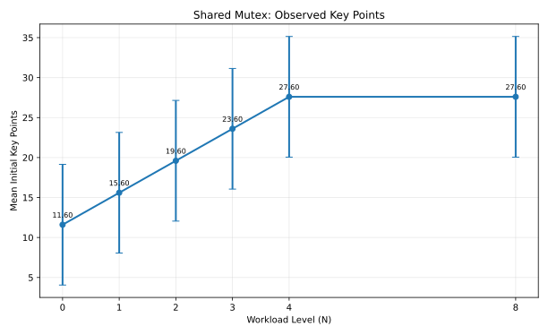
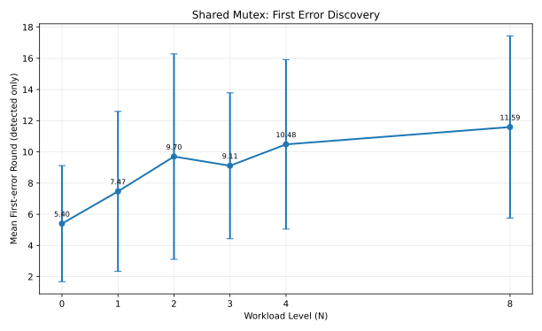
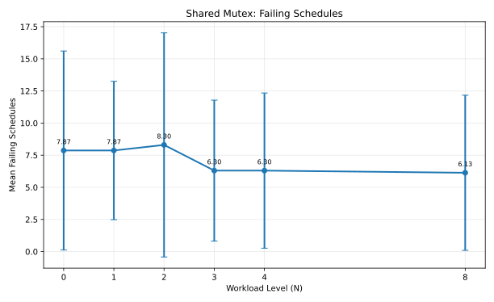
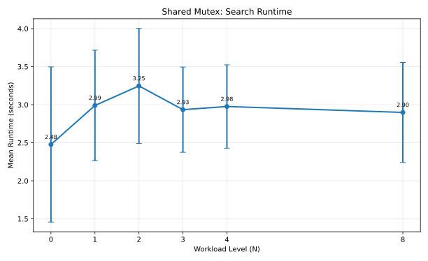

# Shared Mutex + Counter Workload

**Category:** Synchronization workload

## Research question
How does increasing this specific workload structure affect PERIOD's observed Key Points, first-error discovery, failing schedules, and search runtime?

## Workload implementation
A process-wide shared pthread mutex protects a shared volatile counter. Each worker executes N lock → increment → unlock iterations at worker entry.

### Experimental controls
- One shared mutex is visible to the worker threads.
- The counter is shared and incremented while holding the mutex.
- This introduces synchronization and possible inter-thread contention.
- N controls the number of protected increments per worker invocation.

## Configuration
| Parameter | Value |
|---|---|
| Benchmarks | 10 official ConVul-CVE CVEs |
| N levels | 0, 1, 2, 3, 4, 8 |
| Repetitions | 3 per CVE and N |
| Planned runs | 180 |
| Depth bound | 4 |
| Schedule budget | 60 |
| Per-execution timeout | 5 seconds |
| Docker image | `wcventure/period@sha256:8f47d8b9148f2db579627842026e722d0f205ddeab13e70ee41a8df3dbd59fbc` |

## Results
**Valid completed runs: 178/180. Incomplete: 2.**

| N | Valid / planned | Mean KP | Mean first-error round* | Mean failing schedules | Mean runtime (s) |
|---:|---:|---:|---:|---:|---:|
| 0 | 30/30 | 11.60 | 5.40 | 7.87 | 2.48 |
| 1 | 30/30 | 15.60 | 7.47 | 7.87 | 2.99 |
| 2 | 29/30 | 19.60 | 9.70 | 8.30 | 3.25 |
| 3 | 29/30 | 23.60 | 9.11 | 6.30 | 2.93 |
| 4 | 30/30 | 27.60 | 10.48 | 6.30 | 2.98 |
| 8 | 30/30 | 27.60 | 11.59 | 6.13 | 2.90 |

*First-error means are conditional on observed errors and exclude runs with no recorded first-error round. Consult `summary_by_n.csv` for detection coverage.

### Matched N=0 vs N=8 comparisons

| Metric | Matched pairs | Mean change (N8−N0) | Median change | Higher at N8 | Lower at N8 | Unchanged |
|---|---:|---:|---:|---:|---:|---:|
| initial_total_kp | 30 | +16.00 | +16.00 | 30 | 0 | 0 |
| first_error_round | 27 | +7.04 | +8.00 | 23 | 0 | 4 |
| error_schedules | 30 | -1.73 | -2.00 | 5 | 22 | 3 |
| wall_seconds | 30 | +0.42 | +0.29 | 17 | 13 | 0 |

### Figures

| Metric | Figure |
|---|---|
| Observed Key Points |  |
| First Error Discovery |  |
| Failing Schedules |  |
| Search Runtime |  |

## Incomplete run cells

| CVE | N | Repeat | Status |
|---|---:|---:|---|
| CVE-2017-6346 | 2 | 2 | `SEARCH_FAILED_OR_INCOMPLETE` |
| CVE-2017-6346 | 3 | 1 | `SEARCH_FAILED_OR_INCOMPLETE` |

## Limitations
- This is not a pure scheduling-point-only intervention: it adds shared writes, lock/unlock operations, and possible contention.
- The 10-CVE matrix combines 7 newly instrumented benchmarks with 3 earlier compatible workload datasets reused by the sweep driver.
- Original-source sanity baselines are separate from modified N=0 and must not be pooled as identical conditions.
- A 60-schedule budget is not exhaustive; no observed failure does not establish that the bug is absent.
- Failing schedules/interleavings are not counts of distinct bugs.

## Files
- `manifest.json`: exact workload and run configuration.
- `results/runs.csv`: run-level records, including incomplete statuses.
- `results/group_summary_by_cve_n.csv`: CVE × N summaries.
- `results/summary_by_n.csv`: CVE-balanced overall summary.
- `results/paired_n0_vs_n8.csv`: matched benchmark/repetition comparisons.
- `results/hash_consistency.csv`: per-benchmark source/binary/config hash consistency.
- `figures/`: PNG and SVG versions of the four metrics.

## Reproduction
The experiment drivers are in `../../scripts/`. They require the PERIOD Docker image and the original `period_all_cve_sweep.py` dependencies/configuration. See the top-level README before rerunning.
