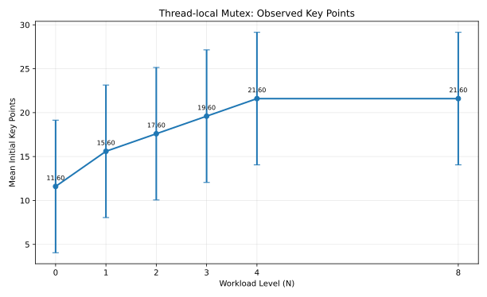
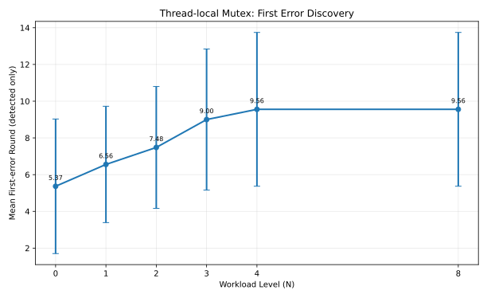
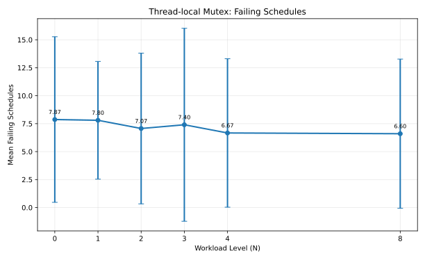
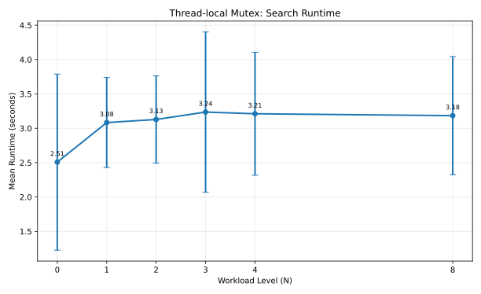

# Thread-local Mutex Workload

**Category:** Thread-local synchronization / lock-lifecycle workload

## Research question
How does increasing this specific workload structure affect PERIOD's observed Key Points, first-error discovery, failing schedules, and search runtime?

## Workload implementation
Each worker invocation creates its own local pthread mutex, performs N lock/unlock pairs, then destroys that mutex. There is no shared counter or shared added mutex.

### Experimental controls
- Each worker uses a mutex local to that worker invocation.
- The added mutex is not shared between threads, so it does not create inter-thread contention through this added lock.
- N controls the number of lock/unlock pairs.
- The lock lifecycle and executed instructions still change.

## Configuration
| Parameter | Value |
|---|---|
| Benchmarks | 10 official ConVul-CVE CVEs |
| N levels | 0, 1, 2, 3, 4, 8 |
| Repetitions | 3 per CVE and N |
| Planned runs | 180 |
| Depth bound | 4 |
| Schedule budget | 60 |
| Per-execution timeout | 5 seconds |
| Docker image | `wcventure/period@sha256:8f47d8b9148f2db579627842026e722d0f205ddeab13e70ee41a8df3dbd59fbc` |

## Results
**Valid completed runs: 166/180. Incomplete: 14.**

| N | Valid / planned | Mean KP | Mean first-error round* | Mean failing schedules | Mean runtime (s) |
|---:|---:|---:|---:|---:|---:|
| 0 | 27/30 | 11.60 | 5.37 | 7.87 | 2.51 |
| 1 | 28/30 | 15.60 | 6.56 | 7.80 | 3.08 |
| 2 | 29/30 | 17.60 | 7.48 | 7.07 | 3.13 |
| 3 | 27/30 | 19.60 | 9.00 | 7.40 | 3.24 |
| 4 | 28/30 | 21.60 | 9.56 | 6.67 | 3.21 |
| 8 | 27/30 | 21.60 | 9.56 | 6.60 | 3.18 |

*First-error means are conditional on observed errors and exclude runs with no recorded first-error round. Consult `summary_by_n.csv` for detection coverage.

### Matched N=0 vs N=8 comparisons

| Metric | Matched pairs | Mean change (N8−N0) | Median change | Higher at N8 | Lower at N8 | Unchanged |
|---|---:|---:|---:|---:|---:|---:|
| initial_total_kp | 24 | +10.00 | +10.00 | 24 | 0 | 0 |
| first_error_round | 23 | +5.04 | +5.00 | 20 | 0 | 3 |
| error_schedules | 24 | -0.17 | +0.00 | 9 | 11 | 4 |
| wall_seconds | 24 | +0.93 | +0.73 | 16 | 8 | 0 |

### Figures

| Metric | Figure |
|---|---|
| Observed Key Points |  |
| First Error Discovery |  |
| Failing Schedules |  |
| Search Runtime |  |

## Incomplete run cells

| CVE | N | Repeat | Status |
|---|---:|---:|---|
| CVE-2013-1792 | 0 | 3 | `SEARCH_TIMEOUT` |
| CVE-2013-1792 | 8 | 2 | `SEARCH_TIMEOUT` |
| CVE-2016-1972 | 8 | 1 | `SEARCH_TIMEOUT` |
| CVE-2016-1973 | 4 | 3 | `SEARCH_FAILED_OR_INCOMPLETE` |
| CVE-2017-6346 | 0 | 1 | `SEARCH_FAILED_OR_INCOMPLETE` |
| CVE-2017-6346 | 0 | 2 | `SEARCH_FAILED_OR_INCOMPLETE` |
| CVE-2017-6346 | 1 | 3 | `SEARCH_FAILED_OR_INCOMPLETE` |
| CVE-2017-6346 | 2 | 3 | `SEARCH_FAILED_OR_INCOMPLETE` |
| CVE-2017-6346 | 3 | 2 | `SEARCH_FAILED_OR_INCOMPLETE` |
| CVE-2017-6346 | 3 | 3 | `SEARCH_FAILED_OR_INCOMPLETE` |
| CVE-2017-6346 | 4 | 2 | `SEARCH_FAILED_OR_INCOMPLETE` |
| CVE-2017-15265 | 1 | 2 | `SEARCH_FAILED_OR_INCOMPLETE` |
| CVE-2017-15265 | 3 | 3 | `SEARCH_FAILED_OR_INCOMPLETE` |
| CVE-2017-15265 | 8 | 1 | `SEARCH_FAILED_OR_INCOMPLETE` |

## Limitations
- This is a thread-local mutex ablation, not a pure Key-Point-only intervention.
- Absence of inter-thread contention on the added mutex does not mean the added instructions have no effect on timing or scheduling.
- A 60-schedule budget is not exhaustive; no observed failure does not establish that the bug is absent.
- Failing schedules/interleavings are not counts of distinct bugs.

## Files
- `manifest.json`: exact workload and run configuration.
- `results/runs.csv`: run-level records, including incomplete statuses.
- `results/group_summary_by_cve_n.csv`: CVE × N summaries.
- `results/summary_by_n.csv`: CVE-balanced overall summary.
- `results/paired_n0_vs_n8.csv`: matched benchmark/repetition comparisons.
- `results/hash_consistency.csv`: per-benchmark source/binary/config hash consistency.
- `figures/`: PNG and SVG versions of the four metrics.

## Reproduction
The experiment drivers are in `../../scripts/`. They require the PERIOD Docker image and the original `period_all_cve_sweep.py` dependencies/configuration. See the top-level README before rerunning.
