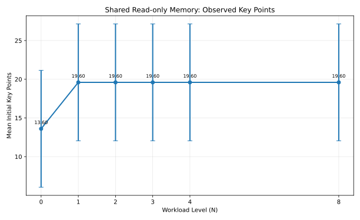
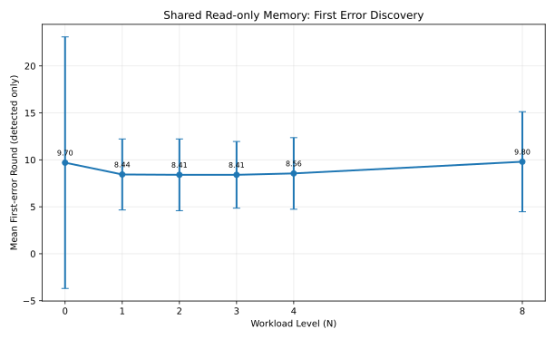
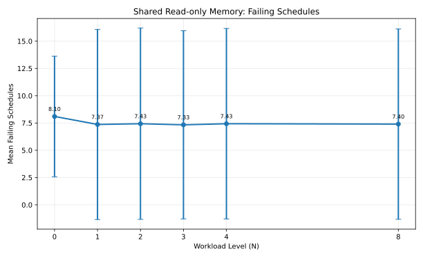
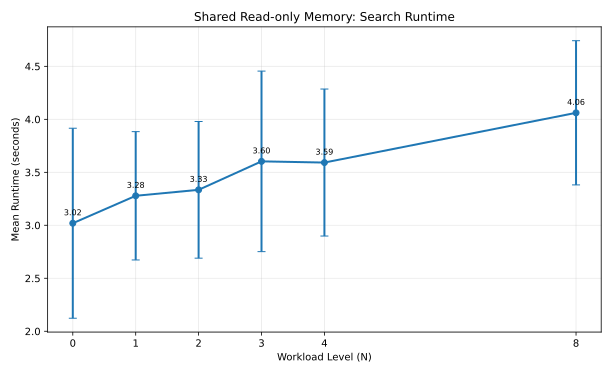

# Shared Read-only Memory-access Workload

**Category:** Memory-access workload

## Research question
How does increasing this specific workload structure affect PERIOD's observed Key Points, first-error discovery, failing schedules, and search runtime?

## Workload implementation
A shared volatile table is initialized in main before pthread_create. Workers only read 8*N active values plus one zero sentinel. The read source line is manually appended to ConConfig.

### Experimental controls
- The shared table is initialized before worker creation.
- Worker threads only read the table; no worker-side table writes.
- No additional mutex, shared counter, or atomic operation is added.
- N controls 8*N active entries plus one sentinel read per worker.
- One static read site repeats dynamically; it does not create 8*N distinct static source locations.

## Configuration
| Parameter | Value |
|---|---|
| Benchmarks | 10 official ConVul-CVE CVEs |
| N levels | 0, 1, 2, 3, 4, 8 |
| Repetitions | 3 per CVE and N |
| Planned runs | 180 |
| Depth bound | 4 |
| Schedule budget | 60 |
| Per-execution timeout | 5 seconds |
| Docker image | `wcventure/period@sha256:8f47d8b9148f2db579627842026e722d0f205ddeab13e70ee41a8df3dbd59fbc` |

## Results
**Valid completed runs: 175/180. Incomplete: 5.**

| N | Valid / planned | Mean KP | Mean first-error round* | Mean failing schedules | Mean runtime (s) |
|---:|---:|---:|---:|---:|---:|
| 0 | 30/30 | 13.60 | 9.70 | 8.10 | 3.02 |
| 1 | 30/30 | 19.60 | 8.44 | 7.37 | 3.28 |
| 2 | 29/30 | 19.60 | 8.41 | 7.43 | 3.33 |
| 3 | 27/30 | 19.60 | 8.41 | 7.33 | 3.60 |
| 4 | 29/30 | 19.60 | 8.56 | 7.43 | 3.59 |
| 8 | 30/30 | 19.60 | 9.80 | 7.40 | 4.06 |

*First-error means are conditional on observed errors and exclude runs with no recorded first-error round. Consult `summary_by_n.csv` for detection coverage.

### Matched N=0 vs N=8 comparisons

| Metric | Matched pairs | Mean change (N8−N0) | Median change | Higher at N8 | Lower at N8 | Unchanged |
|---|---:|---:|---:|---:|---:|---:|
| initial_total_kp | 30 | +6.00 | +6.00 | 30 | 0 | 0 |
| first_error_round | 28 | +1.96 | +3.00 | 24 | 1 | 3 |
| error_schedules | 30 | -0.70 | -2.50 | 5 | 18 | 7 |
| wall_seconds | 30 | +1.04 | +0.82 | 23 | 7 | 0 |

### Figures

| Metric | Figure |
|---|---|
| Observed Key Points |  |
| First Error Discovery |  |
| Failing Schedules |  |
| Search Runtime |  |

## Incomplete run cells

| CVE | N | Repeat | Status |
|---|---:|---:|---|
| CVE-2013-1792 | 2 | 3 | `SEARCH_TIMEOUT` |
| CVE-2013-1792 | 3 | 3 | `SEARCH_TIMEOUT` |
| CVE-2017-6346 | 3 | 1 | `SEARCH_FAILED_OR_INCOMPLETE` |
| CVE-2017-6346 | 3 | 2 | `SEARCH_FAILED_OR_INCOMPLETE` |
| CVE-2017-6346 | 4 | 1 | `SEARCH_FAILED_OR_INCOMPLETE` |

## Limitations
- This is a Shared Read-only Memory-access Workload with a manual scheduling-point extension, not a synchronization workload.
- The read source line is manually appended to ConConfig after staticAnalysis.sh; this is not automatic SVF discovery.
- N=0 still executes one sentinel read per worker.
- Timing changes may still alter original bug exposure.
- A 60-schedule budget is not exhaustive; failing schedules are not distinct bug counts.
- Five cells remain incomplete: CVE-2013-1792 N=2 rep=3 and N=3 rep=3 timed out; CVE-2017-6346 N=3 rep=1, N=3 rep=2, and N=4 rep=1 were search-failed/incomplete.

## Files
- `manifest.json`: exact workload and run configuration.
- `results/runs.csv`: run-level records, including incomplete statuses.
- `results/group_summary_by_cve_n.csv`: CVE × N summaries.
- `results/summary_by_n.csv`: CVE-balanced overall summary.
- `results/paired_n0_vs_n8.csv`: matched benchmark/repetition comparisons.
- `results/hash_consistency.csv`: per-benchmark source/binary/config hash consistency.
- `figures/`: PNG and SVG versions of the four metrics.

## Reproduction
The experiment drivers are in `../../scripts/`. They require the PERIOD Docker image and the original `period_all_cve_sweep.py` dependencies/configuration. See the top-level README before rerunning.
