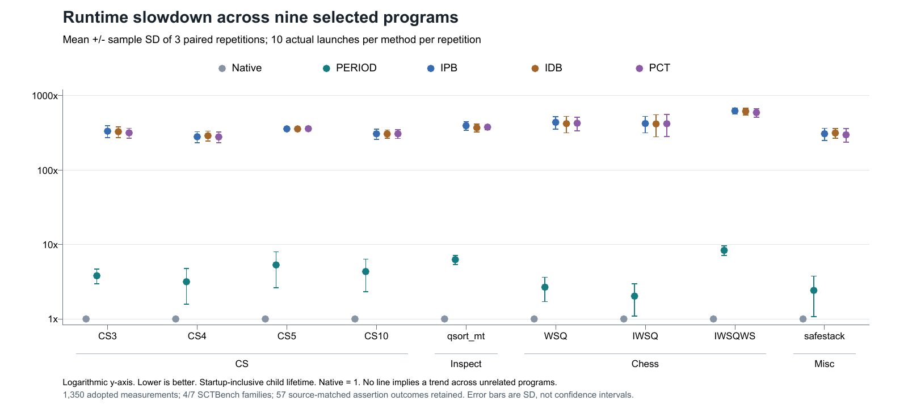

# RQ3 runtime comparison: nine-program review draft

## Scope and metric

We partially reproduce PERIOD Section 4.4 / Figure 7 using nine SCTBench programs from four families: CS (four reorder variants), Inspect (qsort_mt), Chess (WSQ, IWSQ and IWSQWS), and Misc (safestack). Each program receives Native, PERIOD, IPB, IDB and PCT with ten actual measured launches in each of three repeated sessions. The adopted dataset contains 1,350 children, 135 groups and 27 complete five-method paired blocks. This covers 9/36 SCTBench programs and 4/7 families. No CVE runtime measurements are included.

For each program and session, we average the ten measured child lifetimes and divide each method mean by the Native mean from the same session and batch. We then calculate the arithmetic mean and sample SD of the three paired ratios. The statistical repetition unit is the session, not each child. The three sessions reset profiling/search databases and rotate method order, but share one VM and predetermined PCT seeds. Timing is CLOCK_MONOTONIC child lifetime, including sudo, tool/target startup, target execution, debug output and pipe collection. Compilation, static analysis, profiling, PERIOD discovery, driver startup, schedule generation and driver-side DB parsing are excluded. This is a startup-inclusive metric, not pure steady-state scheduling overhead.

## Results

Table 1. Paired slowdown mean +/- sample SD, n=3 sessions.

| Program | PERIOD | IPB | IDB | PCT |
| --- | --- | --- | --- | --- |
| CS.reorder_3_bad | 3.81 +/- 0.85 | 333.01 +/- 58.92 | 327.85 +/- 54.53 | 316.17 +/- 48.37 |
| CS.reorder_4_bad | 3.16 +/- 1.59 | 280.14 +/- 48.06 | 289.10 +/- 44.98 | 278.77 +/- 46.97 |
| CS.reorder_5_bad | 5.32 +/- 2.69 | 357.55 +/- 14.83 | 356.83 +/- 3.36 | 359.48 +/- 8.69 |
| CS.reorder_10_bad | 4.33 +/- 2.01 | 306.87 +/- 47.43 | 305.92 +/- 39.61 | 307.20 +/- 42.30 |
| Inspect.qsort_mt | 6.27 +/- 0.86 | 394.17 +/- 53.02 | 370.10 +/- 44.00 | 377.59 +/- 27.58 |
| Chess.WSQ | 2.67 +/- 0.96 | 438.15 +/- 84.25 | 420.50 +/- 104.28 | 425.94 +/- 89.32 |
| Chess.IWSQ | 2.03 +/- 0.93 | 421.97 +/- 105.16 | 416.98 +/- 137.63 | 419.23 +/- 137.22 |
| Chess.IWSQWS | 8.35 +/- 1.21 | 623.94 +/- 60.56 | 615.44 +/- 66.29 | 591.84 +/- 77.58 |
| Misc.safestack | 2.42 +/- 1.34 | 307.21 +/- 56.17 | 314.62 +/- 46.32 | 297.66 +/- 61.28 |

PERIOD has the lowest measured mean among the four CCT methods on all nine selected programs. Its mean slowdowns range from 2.03x to 8.35x Native; IPB/IDB/PCT means range from 278.77x to 623.94x. These descriptive results support the lower-overhead claim within the selected workload and measurement boundary. They do not establish statistical significance, broad benchmark coverage or the paper's explanation of the performance difference.

Fifty-seven source-file/line-matched assertion outcomes remain in the fixed ten-launch groups: eight PERIOD outcomes from the CS batch and 49 outcomes from the added WSQ/IWSQ measurements. Abnormal exits are accepted only under the predefined target-assertion rules; tool errors, unknown abnormal exits and timeouts are rejected. Assertions may shorten executions and methods explore different schedules, so these runtime averages do not establish bug-finding superiority. success-only-sensitivity.csv is descriptive only and must not replace the fixed-budget primary result.

Figure 1. Logarithmic axis; categorical program spacing. Error bars are mean +/- sample SD, not confidence intervals.

Table 2. Mean child lifetime (seconds), averaged over three session means.

| Program | Native | PERIOD | IPB | IDB | PCT |
| --- | --- | --- | --- | --- | --- |
| CS.reorder_3_bad | 0.016541 | 0.061886 | 5.379337 | 5.303084 | 5.127378 |
| CS.reorder_4_bad | 0.019163 | 0.057260 | 5.269636 | 5.446384 | 5.246049 |
| CS.reorder_5_bad | 0.015215 | 0.080361 | 5.435850 | 5.428420 | 5.468134 |
| CS.reorder_10_bad | 0.017956 | 0.081483 | 5.423686 | 5.423356 | 5.439283 |
| Inspect.qsort_mt | 0.017981 | 0.113996 | 7.013215 | 6.592474 | 6.751229 |
| Chess.WSQ | 0.020630 | 0.057482 | 8.798576 | 8.377861 | 8.535958 |
| Chess.IWSQ | 0.021805 | 0.044731 | 8.767098 | 8.528772 | 8.574319 |
| Chess.IWSQWS | 0.018917 | 0.157343 | 11.727908 | 11.574089 | 11.124342 |
| Misc.safestack | 0.019747 | 0.044021 | 5.907504 | 6.079897 | 5.705930 |

## Setup and deviations

Table 3. Setup and deviations.

| Item | Paper setting | Our setting / reason |
| --- | --- | --- |
| Scope | SCTBench programs with varied thread counts and all CVE programs for RQ3 | Nine selected SCTBench programs, four families; reduced scale. |
| Hardware / system | Intel Xeon Silver 4214 workstation; Ubuntu 18.04 | Windows host, VirtualBox 7.2/NEM, 2 vCPU, 2 GB; Ubuntu 14.04 outer VM, Ubuntu 18.04.5 chroot; Linux 3.16.0-77 for legacy PIN and PERIOD compatibility. |
| Compiler / tools | GCC 7.5, LLVM 10.0; compared CCT implementations | Clang 10, -g -O0, non-PIE; PERIOD commit b6f72a7b06d01ffa7114b640312873ec2578a5ea; Maple/PIN 2.12 and protobuf 2.5. Same input bitcode for native and separately instrumented PERIOD. |
| Repetitions / budget | Section 4.1 describes 10 invocations and up to 10,000 schedules; exact Figure 7 timing boundary unspecified | Three sessions, ten actual measured launches including retests; fixed small budget, not exhaustive coverage. |
| Inputs / parameters | Exact matching Figure 7 input/parameter mapping not fully recovered | Explicit small inputs in Table 4. PCT d=3, n includes main. CS k=8*(workers+1)+16; added programs k is next power of two >=max(256,8*smoke steps). Bounds 0-3 for IPB/IDB. |
| Affinity / clock | Fine-grained timing/affinity details not fully matched | kvm-clock and CLOCK_MONOTONIC. Maple fork disables affinity/FIFO calls; passing cpu=0 does not prove CPU pinning. |
| Completion / assertions | Matching Figure 7 stop/abnormal-exit policy not established | Ten actual children per method. Source-matched assertions included. Explicit budget-stop amendment and whole-block replacement for IWSQWS session 3. |

Table 4. Explicit inputs and PCT settings.

| Program | Arguments | Workers / total | PCT n / k / d |
| --- | --- | --- | --- |
| CS.reorder_3_bad | (none) | 3 / 4 | 4 / 48 / 3 |
| CS.reorder_4_bad | (none) | 4 / 5 | 5 / 56 / 3 |
| CS.reorder_5_bad | (none) | 5 / 6 | 6 / 64 / 3 |
| CS.reorder_10_bad | (none) | 10 / 11 | 11 / 104 / 3 |
| Inspect.qsort_mt | -n 32 -f 4 -h 3 -v | 3 / 4 | 4 / 512 / 3 |
| Chess.WSQ | 1 4 2 | 2 / 3 | 3 / 1024 / 3 |
| Chess.IWSQ | 1 4 2 | 2 / 3 | 3 / 1024 / 3 |
| Chess.IWSQWS | 2 4 2 | 3 / 4 | 4 / 16384 / 3 |
| Misc.safestack | (none) | 3 / 4 | 4 / 1024 / 3 |

## Repair, timing and traceability

The original five-program run completed 71/75 groups. In IWSQWS session 3, a PERIOD automatic retest consumed the tenth actual launch after nine schedule rounds; the observer rejected the next request. Ten completed child logs were valid, but the driver group was incomplete under the old rule. Before rerunning, the protocol was amended to stop PERIOD normally before an eleventh measured child, only when exactly ten valid children have completed, including retests. A distinct completion reason, unique rounds and retest count are retained. Budget exhaustion is not search-space exhaustion. The rerun replaces all five methods of that paired block with 50 new measurements. The original Native 10 and incomplete PERIOD 10 remain diagnostic evidence and are excluded from the adopted 1,350. The other 14 full blocks from the original batch are unchanged. The replacement PERIOD group returned normally after ten measured rounds with zero retests; its saved completion reason is driver_returned.

Table 5. Formal command durations.

| Batch | Beijing start / end | Elapsed | Adopted groups |
| --- | --- | --- | --- |
| B1 | Nov 20 20:28:04 - 21:02:03 | 33m 59.14s | 60 |
| B2 | Nov 20 23:19:04 -Nov 21 00:17:52 | 58m 48.06s | 70 |
| B3 | Nov 21 07:10:39 - 07:19:05 | 8m 25.98s | 5 |

The sum of the three formal command durations is 6073.18 seconds (101min13.18s), including setup/export and diagnostic work in the incomplete batch. It is not the sum of only the1,350 timed child lifetimes and excludes earlier environment setup.

Each selected measurement maps to a source batch and an archive-relative child log in measurements-1350.csv. Full command lines and per-launch classification are retained in merged-records.json. Source manifests and archive hashes are retained separately.

## Paper comparison and claim verdicts

The paper states PERIOD 2-30x and IPB/IDB/PCT 10-500x Native across its evaluated programs. Our PERIOD means lie within that contextual range. Our largest baseline mean is IPB on Chess.IWSQWS: 623.94x, 123.94x (24.79%) above the paper's 500x upper bound. This is a comparison with an aggregate range endpoint, not a matched per-program discrepancy. Exact Figure 7 per-case values and a fully matched timing boundary were not recovered, so per-case absolute and relative gaps are unavailable. Startup, tool configuration and virtualization are plausible influences but have not been separated by controlled measurements and are not established causes.

Table 6. Claim verdicts.

| Claim | Verdict |
| --- | --- |
| Lower PERIOD runtime cost | Supported descriptively on all 9 selected cases; full claim partially reproduced. |
| Exact Figure 7 values | Inconclusive without matched per-case reference data and timing. |
| More threads reduce slowdown | Not established by the CS subset. |
| Better bug-finding performance | Not tested by this runtime experiment. |

The sample is four of seven SCTBench families, with small fixed inputs and only three sessions on one virtualized host. Family diversity is broader than the original four CS cases but is not representative of all programs or bug classes. IWSQWS session 3 is a full replacement sampled later; programs were run in separate batches. Native pairing controls only within the same program/session, and raw seconds must not be pooled across different workloads as equivalent work. No consistent thread-count trend is established by the four CS points. The coarse host-minus-child timing screen found no flags in 135 adopted groups; it cannot establish fine-grained timing precision or exclude host scheduling noise.

## Remaining assignment work

The reduced RQ3 measurement and plotting stage is complete for these nine programs. The group assignment is not complete: the teacher requires a controlled one-factor extension, evidence-based discrepancy analysis and a paper-versus-ours comparison under matched settings. A possible next experiment is budget 5 versus 10 on the same workloads with three new sessions, fixed PCT settings and fresh profiling/search DBs. It has not been run and must not be presented as completed. SWSQ and boundedBuffer remain deferred after their initial execution issues. The team must also confirm author contribution statements, integrate other RQs, prepare portable clean-environment setup/run instructions and review any repository additions. No teammate files, README, commit or push were changed by this analysis.

## Contribution and AI-use statement (draft)

The operator launched the experiments and supplied console output. Codex assisted script preparation, debugging, raw-log auditing, aggregation, figures and this draft. The team must confirm individual authorship and review the interpretation before integrating the report.

## Conclusion

PERIOD has lower observed startup-inclusive runtime cost than IPB, IDB and PCT on the nine selected programs; the broader paper claim is partially reproduced.

Sources: Wen et al., Controlled Concurrency Testing via Periodical Scheduling, ICSE 2022, Sections 4.1/4.4 and Figure 7, https://wcventure.github.io/pdf/ICSE2022_PERIOD.pdf. CS340 Research Paper Replication assignment supplied by the user. Raw verified evidence archives, archived scripts and manifests are indexed by SHA256 in this package.
